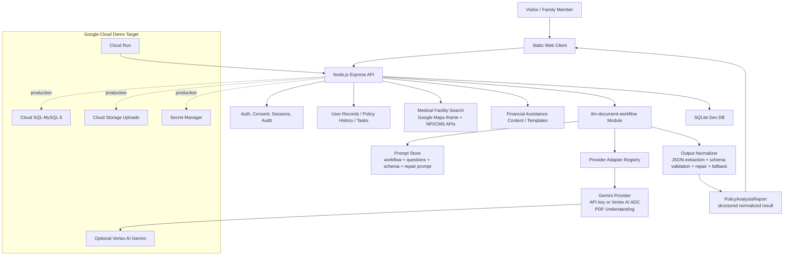

# Architecture Diagram

Submission image:

```text
https://github.com/weiyu1977/GoogleChallenge/blob/main/docs/architecture-diagram.svg
```

Submission markdown:

```text
https://github.com/weiyu1977/GoogleChallenge/blob/main/docs/ARCHITECTURE_DIAGRAM.md
```



## Key Design Points

- The frontend never displays raw model output as the primary user-facing report.
- Gemini handles PDF/scanned PDF understanding through a provider adapter. The default path can use a Gemini API key without requiring a Google Cloud project; Vertex AI ADC is an optional deployment mode.
- `llm-document-workflow` standardizes LLM output into `PolicyAnalysisReport`.
- Diagnostics and raw output are kept for admin/debug views.
- The module is reusable beyond insurance: contracts, bills, receipts, immigration documents, and other PDF workflows.
